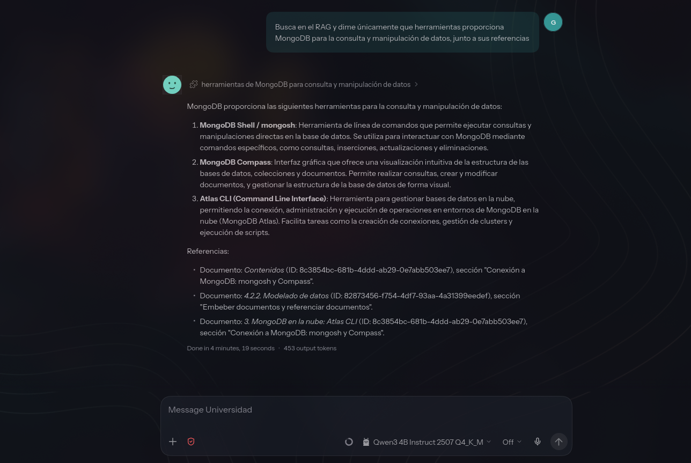

# OpenClaw + haiku-rag

**Tres agentes. Tus documentos. Un único despliegue.**

Tres agentes para consultar tus documentos personales, de la universidad
y del homelab. Cada uno accede únicamente a la base documental de su ámbito.

[Instalación](docs/instalacion.md) · [Uso y mantenimiento](docs/uso.md) · [Arquitectura](docs/arquitectura.md)

Universidad en acción: una consulta sobre MongoDB con referencias a su base documental.

## Un agente para cada tipo de documento

| Agente | Documentación que consulta | Carpeta de documentos |
| --- | --- | --- |
| **Personal** | Documentos personales. | `documents/personal/` |
| **Universidad** | Apuntes y demás documentos de la universidad. | `documents/universidad/` |
| **Técnico-Homelab** | Documentación de tu homelab. | `documents/tecnico/` |

El objetivo es hacer preguntas sobre cada conjunto de documentos manteniéndolos
separados. Elige el agente del ámbito que quieras consultar: sus herramientas
solo le permiten buscar en su propia base y acceder a sus notas.

Los tres viven en un único OpenClaw. Cada agente tiene un workspace para sus
notas y su propio RAG (*Retrieval-Augmented Generation*, o generación apoyada
en documentos recuperados).

Los roles les indican que consulten las fuentes antes de responder, citen el
material utilizado y avisen si falta información. Los permisos limitan sus
herramientas a su base y sus notas: sin comandos, navegación web ni acceso a
sesiones o archivos de otros agentes.

## Qué incluye

- **Ingesta automática.** Añade documentos a la carpeta de cada ámbito; un único
  ingester los procesa y mantiene las tres bases.
- **Búsqueda documental compartiendo recursos.** Ollama genera los embeddings
  con `bge-m3` e Infinity reordena los resultados con `bge-reranker-v2-m3`.
- **PDF por bloques.** Docling convierte en CPU, en bloques de diez páginas,
  para reducir el pico de memoria.
- **Configuración versionada.** Imágenes fijadas, roles editables y parches
  independientes para agentes, conexiones MCP y permisos.
- **Datos persistentes.** Originales, estado y bases se guardan en carpetas
  locales excluidas de Git.

La ingesta y la búsqueda se ejecutan en los contenedores del despliegue. El
modelo de conversación se configura por separado en OpenClaw y puede usar
un proveedor local o remoto; `bge-m3` es el modelo de embeddings.

## Empezar

Necesitas **Linux x86_64**, Docker Engine, **Docker Compose 2.30 o superior**
y una **GPU NVIDIA** con su driver y NVIDIA Container Toolkit configurado.
Ollama e Infinity usan GPU; Docling trabaja en CPU.

1. Sigue la [guía de instalación](docs/instalacion.md) para preparar las carpetas,
   configurar OpenClaw y arrancar los servicios.
2. Aplica los parches en este orden: **agentes → conexiones MCP → permisos**.
   La guía incluye la validación previa de cada uno.
3. [Añade tus documentos](docs/uso.md#añadir-documentos), abre un chat nuevo
   con el agente correspondiente y comprueba sus consultas y referencias.

Si ya tienes OpenClaw configurado, empieza por
[abrir el panel](docs/instalacion.md#4-abrir-el-panel) y continúa con los agentes,
las conexiones y los permisos.

> El panel se publica en `127.0.0.1:18789`. Para abrirlo desde otro equipo,
> la guía explica cómo obtener el enlace de acceso y usar un túnel SSH.

## Documentación

| Guía | Qué encontrarás |
| --- | --- |
| [Instalación](docs/instalacion.md) | Requisitos, primer arranque, panel, roles, MCP y permisos. |
| [Uso y mantenimiento](docs/uso.md) | Ingesta, comprobaciones, cambios de rol, copias de seguridad y resolución de problemas. |
| [Arquitectura y configuración](docs/arquitectura.md) | Servicios, versiones, almacenamiento, variables y límites de acceso. |

Los archivos de configuración están en [`config/`](config/), los roles en
[`config/agents/`](config/agents/) y los servicios en [`compose.yaml`](compose.yaml).

## Alcance del despliegue

La separación entre agentes se aplica mediante permisos de herramientas dentro
de un único Gateway. Los MCP abren sus bases en modo lectura y solo el ingester
las escribe. Los roles describen la conducta esperada; conviene comprobarla con
el modelo de conversación elegido, como indica la guía de instalación.

`data/`, `rag/`, `documents/` y `.env` permanecen fuera del repositorio. Los
canales de mensajería y su enrutamiento se configuran por separado.
